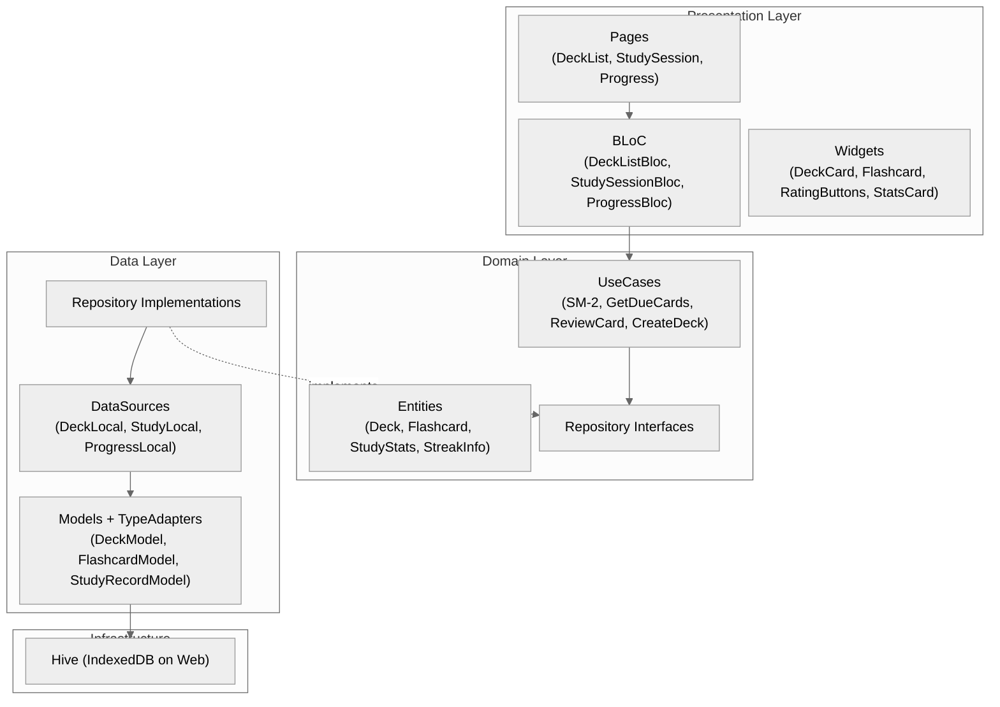

# EduCards — 間隔反復式フラッシュカード学習アプリ

**tf-mobile-env** ショーケースデモアプリ。Claude Code モバイル標準環境パッケージの全 23 コンポーネントを活用して構築した Flutter アプリケーション。

## Overview

| 項目 | 内容 |
|------|------|
| フレームワーク | Flutter (Dart) |
| アーキテクチャ | Clean Architecture (3層) |
| 状態管理 | BLoC (flutter_bloc) |
| ローカル DB | Hive (オフラインファースト) |
| DI | GetIt |
| ナビゲーション | GoRouter |
| テーマ | Material Design 3 (Light + Dark) |
| コアロジック | SM-2 間隔反復アルゴリズム |

## Architecture



## Features

| 機能 | 説明 |
|------|------|
| デッキ管理 | カードデッキの作成・削除 |
| フラッシュカード学習 | カードフリップ、難易度評価 (Again/Hard/Good/Easy) |
| SM-2 アルゴリズム | 間隔反復による最適な復習スケジュール |
| 学習進捗 | 日次統計、連続学習日数 (ストリーク) |
| オフライン対応 | ネットワーク不要で全機能動作 |
| ダークモード | Material 3 シードカラーで自動生成 |
| レスポンシブ | Phone / Tablet / Desktop 対応 |
| アクセシビリティ | Semantics ラベル、48x48dp タッチターゲット |

## Project Structure

```
educards/
├── lib/                          # 60 Dart files
│   ├── main.dart                 # エントリポイント + シードデータ
│   ├── app.dart                  # MaterialApp + GoRouter
│   ├── core/
│   │   ├── constants/            # dimensions
│   │   ├── data/                 # sample_data, seed_data_service
│   │   ├── di/                   # GetIt injection_container
│   │   ├── error/                # exceptions, failures
│   │   ├── theme/                # Material 3 Light/Dark
│   │   ├── usecases/             # UseCase<T, Params> base
│   │   └── widgets/              # adaptive_layout, empty, error, loading
│   └── features/
│       ├── deck/                 # デッキ管理 (CRUD)
│       ├── study/                # 学習セッション + SM-2
│       └── progress/             # 学習進捗 + ストリーク
├── test/                         # 12 test files, 54 tests
│   ├── fixtures/                 # TestFixtures
│   └── features/                 # unit, BLoC, usecase tests
├── docs/adr/                     # 3 ADR documents
├── showcase/before-after/        # Before/After 比較
├── .github/workflows/            # CI/CD (flutter-ci, deploy-web)
└── pubspec.yaml
```

## Quick Start

```bash
# Flutter SDK が必要 (v3.19+)
cd educards
flutter pub get
flutter run -d chrome        # Web
flutter run -d <device_id>   # Mobile
```

## Tests

```bash
flutter test                    # 54 tests
flutter test --coverage         # with coverage
flutter analyze                 # 0 issues
```

## SM-2 Algorithm

EduCards のコアロジックである SM-2 (SuperMemo 2) 間隔反復アルゴリズム:

```
EF' = EF + (0.1 - (5-q) * (0.08 + (5-q) * 0.02))
EF  = max(EF', 1.3)

質  >= 3:  interval = { rep0: 1日, rep1: 6日, repN: prev * EF }
質  <  3:  interval = 0, reps = 0, 10分後に再出題
```

17 の境界値テストで正確性を保証。

## tf-mobile-env Component Coverage

全 23 コンポーネントを活用 (100%):

| カテゴリ | コンポーネント | 活用場面 |
|---------|--------------|---------|
| Agent | mobile-architect | Clean Architecture 設計, ADR |
| Agent | ui-ux-reviewer | アクセシビリティ監査 |
| Agent | mobile-tdd-guide | SM-2 TDD, BLoC テスト |
| Agent | platform-bridge | Pigeon TTS 設計 |
| Agent | release-manager | Fastlane 設定 |
| Rule | mobile-architecture | 3層構造, UseCase パターン |
| Rule | responsive-design | 3ブレークポイント |
| Rule | offline-first | Cache First, Hive |
| Rule | mobile-security | Secure Storage |
| Rule | accessibility | Semantics, タッチターゲット |
| Rule | battery-performance | const, ListView.builder |
| Rule | mobile-testing | テストピラミッド |
| Rule | store-guidelines | Privacy Manifest |
| Skill | app-scaffold | プロジェクトテンプレート |
| Skill | state-management | BLoC パターン |
| Skill | deeplink-setup | GoRouter ディープリンク |
| Skill | push-notification | ローカル通知 |
| Skill | store-submission | Fastlane |
| Skill | ci-mobile | GitHub Actions |
| Command | /mobile-review | アーキテクチャ + UI/UX レビュー |
| Command | /mobile-tdd | TDD ワークフロー |
| Command | /device-matrix | デバイス互換性 |
| Command | /store-check | ストア申請チェック |

## Metrics

| メトリクス | 値 |
|-----------|-----|
| Dart ファイル (lib/) | 60 |
| テストファイル | 12 |
| テスト数 | 54 |
| flutter analyze | 0 issues |
| ADR | 3 |
| BLoC | 3 |
| Hive TypeAdapter | 4 |
| サンプルデッキ | 2 (各20枚) |
| レスポンシブ BP | 3 |

## ADR (Architecture Decision Records)

| # | タイトル | 決定 |
|---|---------|------|
| 001 | 状態管理パターン | BLoC (flutter_bloc v9.x) |
| 002 | ローカルDB | Hive v2.2.3 (Manual TypeAdapter) |
| 003 | 間隔反復アルゴリズム | SM-2 (SuperMemo 2) |

## License

MIT
